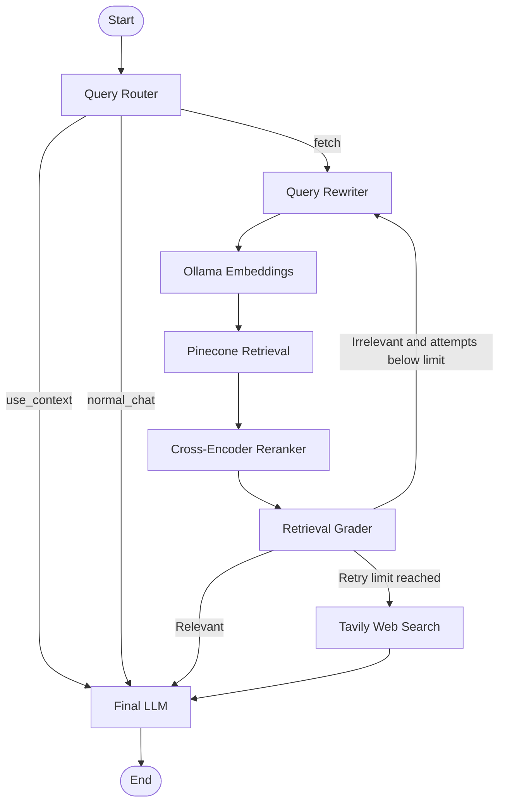

# Agentic RAG — Intelligent Knowledge Retrieval System

An Agentic Retrieval-Augmented Generation (RAG) system built with Python, LangGraph, Pinecone, and LLMs. It intelligently routes user queries, rewrites search queries, retrieves relevant documents, reranks results, evaluates retrieval quality, and falls back to web search when the knowledge base cannot provide sufficient information.

## Features

- **Intelligent Query Routing** — Classifies queries into `fetch`, `use_context`, or `normal_chat`.
- **Query Rewriting** — Converts ambiguous questions and follow-ups into self-contained search queries using conversation history.
- **Vector Retrieval** — Generates query embeddings using Ollama and retrieves relevant document chunks from Pinecone.
- **Cross-Encoder Reranking** — Reorders retrieved chunks based on query-document relevance.
- **Retrieval Grading** — Evaluates whether retrieved documents are relevant to the user's question.
- **Iterative Retrieval** — Rewrites the query and retries retrieval when the results are irrelevant.
- **Web Search Fallback** — Uses Tavily after repeated unsuccessful retrieval attempts.
- **Conversation History** — Maintains user and assistant messages across multiple turns.
- **Synchronous Execution** — Uses regular Python functions, synchronous LLM calls, and `graph.invoke()`.
- **Source-Aware Answers** — Supplies retrieved documents and web-search results to the answer-generation model.

## Architecture



## Workflow

### 1. Query Routing

The router determines whether the latest user message needs document retrieval, can be answered using available conversation context, or is normal conversation.

- `fetch`: retrieve information from the knowledge base.
- `use_context`: answer using sufficient existing context.
- `normal_chat`: handle greetings and general conversation.

### 2. Query Rewriting

The rewriter generates a self-contained search query using the current question, conversation history, and previous rewritten queries.

For example:

**Original question:** "Why do we need it?"

**Rewritten query:** "Benefits of database replication, including high availability, read scalability, and fault tolerance."

### 3. Vector Retrieval

The system generates an embedding for the rewritten query using the `mxbai-embed-large` Ollama model and searches the `ddia` namespace in Pinecone.

The retriever requests the top 10 candidate chunks.

### 4. Reranking

A Cross-Encoder model, `cross-encoder/ms-marco-MiniLM-L-6-v2`, scores each query-document pair and ranks the retrieved chunks.

The top three chunks are passed to the relevance grader.

### 5. Retrieval Grading and Retry

The grader returns one of two decisions:

- `relevant`: proceed to answer generation.
- `irrelevant`: rewrite the query and retry retrieval if attempts remain.

After three unsuccessful retrieval attempts, the workflow falls back to web search.

### 6. Web Search Fallback

Tavily searches the web using the current rewritten query, falling back to the original question if necessary. The resulting titles, URLs, and content are supplied to the final LLM.

### 7. Answer Generation

The final LLM combines available retrieved information, web results, and conversation history to answer the original user question.

The application maintains conversation history across turns while resetting query-specific retrieval state for each new question.

## Technology Stack

| Component | Technology |
|---|---|
| Language | Python |
| Agent orchestration | LangGraph |
| LLM integration | LangChain |
| Language model | Groq-hosted model via `ChatGroq` |
| Embeddings | Ollama — `mxbai-embed-large` |
| Vector database | Pinecone |
| Reranking | Sentence Transformers Cross-Encoder |
| Web search | Tavily |
| Configuration | `python-dotenv` |

## Project Structure

```text
agentic-rag/
├── notebook.ipynb
├── .env
├── .gitignore
└── README.md
```

The notebook contains the state definition, LLM configuration, graph nodes, routing logic, retrieval pipeline, and interactive chat loop.

## Setup and Installation

### Prerequisites

- Python 3.10+
- Ollama installed and running
- Pinecone API key
- Groq API key
- Tavily API key

### 1. Clone the repository
### 2. Create a virtual environment
### 3. Activate it 
### 4. Install dependencies from requirements.txt
### 5. Configure environment variables

Create a `.env` file in the project root:

```env
groqAPIKey=your_groq_api_key
PINECONE_APIKEY=your_pinecone_api_key
TAVILY_API_KEY=your_tavily_api_key
```

Never commit your `.env` file or expose API keys in source control.

### 6. Start Ollama

Ensure Ollama is running and pull the embedding model:

```bash
ollama pull mxbai-embed-large
```

### 7. Configure Pinecone

Ensure the Pinecone index `ddia-ollama-vectors` exists and is configured for the embedding dimension produced by `mxbai-embed-large`.

The index must contain your document chunks and metadata, including the `text` field, in the `ddia` namespace.

### 8. Run the notebook

```bash
jupyter notebook
```

Open `notebook.ipynb`, execute the cells in order, and start asking questions.

## Example Interaction

```text
You: Explain database replication.

Assistant:
Database replication maintains multiple copies of a database
across different nodes to improve availability and scalability.

You: Why do we need it?

Assistant:
Replication can improve fault tolerance, distribute read traffic,
and reduce latency for geographically distributed users.
```

The second question uses conversation history to resolve "it" to database replication.

## Design Considerations

- **State isolation:** retrieval results and retry counters are reset for each independent user query.
- **Conversation continuity:** user and assistant messages persist across turns within the running CLI session.
- **Bounded retries:** retrieval retries are limited to prevent unbounded loops.
- **Evidence quality:** reranking and grading help improve retrieval relevance.
- **Fallback strategy:** web search provides another source when the local knowledge base is insufficient.
- **Synchronous control flow:** the current implementation uses synchronous execution rather than `async` and `await`.

## Current Limitations

- Conversation history is held in memory and is lost when the application restarts.
- The current chat loop supports a single conversation rather than isolated multi-user sessions.
- Retrieval grading checks relevance, which does not guarantee that the documents fully answer the question.
- Reranking always selects up to three chunks when candidates are available, without a configurable relevance threshold.
- The notebook's synchronous LLM invocation does not provide token-by-token output to the terminal.
- Source attribution and citation formatting depend on the metadata and URLs supplied to the final LLM.

## Future Improvements

- Add persistent conversation state using LangGraph checkpointers.
- Add per-user and per-conversation session isolation.
- Improve grading to evaluate evidence sufficiency and answerability.
- Add configurable retrieval thresholds and hybrid search.
- Implement token-by-token streaming.
- Add structured logging, latency metrics, and retrieval evaluation.
- Add automated tests for routing, retries, retrieval, and fallback behavior.
- Deploy the system behind a FastAPI backend.


